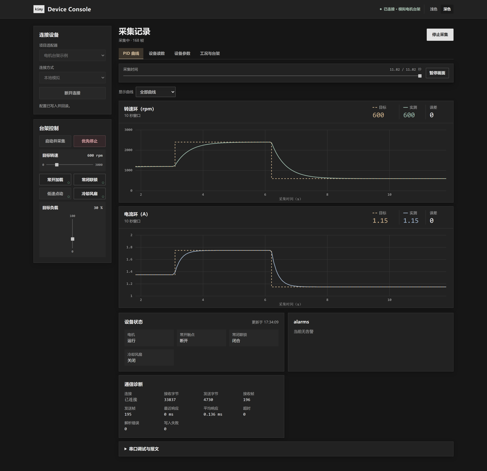
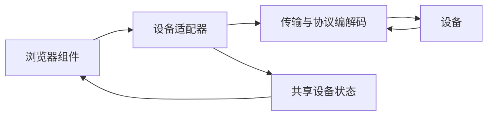

# kimy Device Console

### 让 AI 一键适配设备，在浏览器里直接调试

面向电赛智能小车、电机实验台和传感器节点等设备的多协议调试控制台。可通过串口或 BLE 现场接入，也可经 TCP/UDP 或 WebSocket 远程连接网络设备，查看状态与实时曲线、读写参数、发送指令，并保存报文和采样数据。

把协议文档、固件源码或通信日志交给 AI Agent，再复制「完整适配器」或「简易适配器」提示词。Agent 会先研究项目代码和已有资料，生成设备适配层；资料缺少关键协议时会列出待确认项。

界面和本地服务使用 Node.js 原生 API，无需安装 npm 依赖。



## 给使用者

### 工作原理



主程序负责界面、连接、采集和日志。适配器负责把设备协议转换成统一的状态和操作。设备参数、滑块、开关和工况点共用适配器写入流程，写入后固定回读设备状态，再同步所有组件。

### 让 Agent 接入设备

1. 直接复制下面的完整或简易提示词，交给当前仓库中的 Agent。
2. Agent 会先阅读代码、README 和工作区中已有的设备资料，再自行研究适配方式。
3. 如果有未放入工作区的资料或额外要求，可自行补充到提示词末尾。

如果需求只是协议、设备参数、状态或控制方式不同，先让 Agent 修改适配器。适配器确实无法表达时，再新增通用组件；只有组件无法满足页面组织需求时，才新增面板。

### 完整适配器

```text
按照本仓库 README 中「给 AI Agent」部分的规范，先阅读项目代码和工作区或当前对话中的设备资料，自行了解项目后，为目标设备构建完整适配器并完成验证。
```

### 简易适配器

```text
按照本仓库 README 中「给 AI Agent」部分的规范，先阅读项目代码和工作区或当前对话中的设备资料，自行了解项目后，为目标设备构建简易适配器，只保留基础必需功能并完成验证。
```

### 启动与验收

运行需要 Node.js 24。没有随项目提供 `runtime/node.exe` 时，在 Windows 上可使用已安装的 Node.js。双击 `start.cmd` 可启动服务，也可以在项目目录运行：

```sh
node server.mjs
```

使用桌面版 Chrome 或 Edge 打开终端显示的本机地址，默认是 `http://127.0.0.1:8765`。默认端口被占用时会尝试 `8766`。可用 `DEVICE_CONSOLE_PORT` 指定端口，用 `DEVICE_CONSOLE_LOGS` 指定日志目录。修改适配器后重启服务并刷新页面。

适配器完成后，选择对应项目和连接方式，连接设备并查看状态。写入任一配置后，检查参数框、滑块和状态值是否都与设备回读一致。采样曲线需要点击「开始采集」。报文日志和有采样时生成的 CSV 可从页面下载，也保存在 `logs/`。

## 给 AI Agent

以下部分是适配器实现契约。实现设备接入时以这些接口和现有代码为准，协议细节以用户提供的资料为准。

### 修改范围与入口

- `index.html` 和 `server.mjs` 都从 `adapters/example.mjs` 导入 `adapters`。单设备优先修改该文件。增加独立适配器文件时，更新这两个入口，让浏览器和本地服务使用同一份适配器映射。
- 适配器映射的键是项目 ID，值至少包含 `label`。按需提供 `transports`、`codec`、`channels`、`panels`、`status`、`write`、`sample`、`onFrame` 和 `command`。
- 不新增 npm 依赖。设备素材放在 `adapters/assets/`，通过 `new URL("./assets/file", import.meta.url)` 引用。

实现新需求时按此顺序判断：先看适配器回调和配置能否完成；现有组件无法表达所需交互时，再实现可复用组件；已有组件无法满足页面组织时，通过适配器的 `panels` 组合面板。不要把单个设备的协议和行为写进通用组件或主界面。

### 配置写入与回读

所有结构化配置写入都调用 `api.configure(changes)`。固定顺序如下：

1. 控制台标记被修改的配置项为待确认，并暂停其他配置写入。
2. 调用适配器唯一的 `write(api, changes)` 回调发送配置。`changes` 是由数值、布尔值或文本组成的键值对象；回调不能递归调用 `api.configure`。
3. 写入成功后调用 `status(api)`，读取设备当前状态。写入回执失败时也会尝试回读，以处理设备已应用但回执丢失的情况。
4. 将 `status` 返回的 `values` 合并到共享状态。所有绑定这些键的参数框、滑块、开关和图表随之更新。

`status(api)` 必须返回 `{ values, rows, running }` 中适用的字段。`values` 必须是对象，并包含需要同步的全部配置键，不能只返回本次修改的部分。回读缺少待确认配置项时，控制台会保留待确认状态并重试状态查询。配置项只有被回读确认后才会重新开放写入。

面板中的参数组件只登记数值参数，不提供单独的读写回调。读取按钮调用 `api.readback()`，写入按钮调用 `api.configure({ [key]: value })`。普通滑块、开关和工况点的 `run(api, value)` 也应调用 `api.configure`。不要在这些配置回调里直接用 `api.send` 绕过统一写入流程。

设备主动上报可通过 `onFrame(frame, memory)` 返回 `{ status, values, sample }`。待确认的配置键不会被异步上报覆盖，最终以统一状态回读为准。

### 适配器回调

| 回调 | 用途 |
| --- | --- |
| `status(api)` | 读取设备状态，返回 `{ values, rows, running }`。连接时调用，采集期间按 `statusIntervalMs` 刷新，默认 500 ms。 |
| `write(api, changes)` | 配置的唯一协议写入口。校验并发送 `changes`，等待设备写入回执后返回。控制台随后自动调用 `status(api)`。回调中使用 `api.ask` 或 `api.send` 完成实际协议交互，不要在其中再调用 `api.configure`。 |
| `command(api, text)` | 解析控制台中的文本命令。识别为配置修改时调用 `api.configure(changes)`，普通操作可调用 `api.ask` 或 `api.send`。 |
| `sample(api)` | 采集期间读取一帧数据，返回 `{ points, tick }`。返回 `undefined` 跳过本帧，返回 `null` 停止轮询。 |
| `onFrame(frame, memory)` | 同步处理设备主动上报，可返回 `{ status, values, sample }`。不要声明为 `async`。 |

控件的 `run(api, value)` 可以调用 `api.ask(command, parse, timeoutMs)` 等待回执。`parse(frame)` 返回 `undefined` 表示继续等待，返回其他值表示请求完成。`command` 设为 `null` 时只等待回执。`timeoutMs` 包含写入等待和回执等待。单个连接同一时间只能有一个 `api.ask` 请求。

用 `api.publish(values)` 合并状态，用 `api.log(text)` 记录事件，用 `api.progress(text)` 更新操作提示。`api.values` 是当前连接的共享状态，`api.memory` 在一次连接内共享，`api.signal` 用于取消操作。`api.send(command)` 按适配器编码发送，`api.sendRaw(bytes, label)` 原样发送 `Uint8Array`。`api.sources()` 读取适配器登记的项目文件。

### 连接与协议

| 配置 | 用法 |
| --- | --- |
| `transports.serial` | USB 串口、系统 COM 口或蓝牙 SPP。常用参数是 `baudRate`。浏览器使用端口选择器。 |
| `transports.ble` | 可配置 `service`、`write`、`notify`、`filters` 和 `chunkSize`。省略三个 UUID 时自动匹配 Nordic UART 或 FFE0/FFE1。 |
| `transports.tcp` | 提供 `host` 和 `port`。由本地 Node.js 服务连接设备。 |
| `transports.udp` | 提供对端 `host`、`port`，可选 `localPort` 接收设备主动上报。 |
| `transports.websocket` | 提供 `url`，可选 `protocols`。默认发送文本，设置 `binary: true` 时发送二进制。 |
| 自定义连接 | `open({ receive, lost, signal })` 返回 `{ name, write(bytes), close() }`。收到字节调用 `receive(bytes)`，意外断开调用 `lost(reason)`。 |
| `codec` | 默认是 UTF-8 换行文本。自定义时提供 `encode(payload)` 和 `decoder(emit)`，解码出完整帧后调用 `emit(frame)`，可选 `format(value)` 定义日志文本。 |

串口文本输入在提供 `command` 回调时由适配器解析；未提供时直接透传文本。十六进制输入按原始字节发送，适配器提供 `status` 时发送后会回读状态。配置命令应由适配器解析后调用 `api.configure`。

### 面板与组件

用 `panels` 数组登记面板，`modules` 对象按 ID 配置组件。也可在顶层登记 `modules` 后由面板引用。

| 组件 | 配置要点 |
| --- | --- |
| `curve` | 用 `channel` 指定通道，可设 `windowMs`、`gapMs`、`unit` 和 `series`。 |
| `value`、`bar`、`table` | 数据源 `source` 可用共享状态键或 `{ channel, series }`。条形图可设 `min`、`max`，表格以 `rows` 登记。 |
| `status`、`console` | 状态组件显示 `rows`。控制台显示收发日志，可设 `open: true` 默认展开。 |
| `alarms` | `source` 指向共享状态中的告警数组。告警可含 `id`、`code`、`label`、`severity`、`message`、`timestamp`、`active`、`acknowledged`。等级为 `critical`、`warning` 或 `info`。可提供 `acknowledge(api, alarm)`。 |
| `parameters` | 用 `parameters` 登记 `{ key, label, min, max, step, unit }`。键不能重复，写入走 `api.configure`。适配器需实现 `write` 和完整 `status.values`。 |
| `diagnostics` | 自动显示连接状态、收发字节与帧数、请求超时、解析错误、写入失败和响应延迟。 |
| `button` | 点击执行 `run(api)`。可设 `stop: true`、`motion: true`、`enabledWhen(values)` 和 `record`。配置修改应走 `api.configure`。 |
| `normally-open`、`momentary` | 按下和松开分别向 `run(api, value)` 传入 `true`、`false`。 |
| `normally-closed` | 按下和松开分别传入 `false`、`true`。 |
| `toggle`、`slider` | 交替按键可设 `initial`。滑块可设 `min`、`max`、`step`、`initial`、`unit` 和方向。绑定键应是 `status.values` 中的配置项。 |
| `xy` | 可用常量、共享状态键或采样通道配置点和线。交互回调收到 `{ id, kind, label, x, y }`，配置修改应走 `api.configure`。 |
| `image`、`svg` | 素材放在 `adapters/assets/`。项目内 SVG 可通过 `new URL(..., import.meta.url)` 引用。 |

面板位置使用 `main`、`sidebar` 或 `footer`。可设置 `columns`、`mobileColumns`、`wide`、`span` 和 `panelMode`。图片样式可配置宽高、对齐、背景和 `fit`。

### 验收清单

- 运行 `node --check adapters/example.mjs`，并检查其他修改过的 `.mjs` 文件。
- 启动 `node server.mjs`，在浏览器用「本地模拟」验证连接、状态、配置写入和状态回读。
- 检查从不同组件修改同一个配置键时，其他组件都显示回读值。
- 检查写入失败或回读缺字段时，控制台保留待确认状态并允许断开连接。
- 只有用户要求并提供实物设备时，才进行硬件连接验证。
