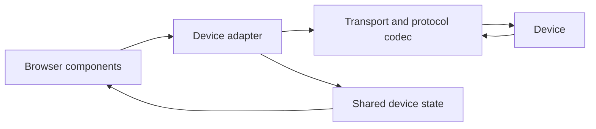

# Patchbay

English | [简体中文](README_zh.md)

### Build a device adapter with AI and debug it in your browser

A multi-protocol console for devices such as competition robots, motor benches, and sensor nodes. Connect locally over serial or BLE, or connect to network devices over TCP/UDP or WebSocket. Inspect status and live plots, read and write settings, send commands, and save message logs and sampled data. The interface defaults to English and can be switched to Simplified Chinese.

Give an AI agent protocol documents, firmware source code, or communication logs, then copy the full or basic adapter prompt below. The agent will inspect the project and available materials before generating a device adapter. If essential protocol details are missing, it will list the questions that need answers.

The browser interface and local Node.js service use built-in APIs and require no npm dependencies.


## For Users

### Start

Node.js 24 is required. On Windows, double-click `start.cmd`. It uses `runtime/node.exe` when present and otherwise falls back to the system Node.js installation. You can also run this command from the project directory.

```sh
node server.mjs
```

Open the local address shown in the terminal using desktop Chrome or Edge. The default address is `http://127.0.0.1:8765`. If the default port is already in use, the server tries `8766`. Set `DEVICE_CONSOLE_PORT` to choose a port or `DEVICE_CONSOLE_LOGS` to choose a log directory. Restart the server and refresh the page after changing an adapter.

### Try the Motor Bench

1. Select **Motor bench example** and **Local simulation**, then click **Connect device**.
2. In the **PID plots** tab, edit the speed setpoint, load setpoint, or protection limits in **Tuning**. Edited fields are highlighted. Click **Apply N changes** or press Enter in a field to write them together. The device values are read back automatically. **Read device** refreshes device values while preserving drafts, and **Undo changes** restores the latest device values.
3. Click **Start and capture** to run the simulated motor. Adjust the sidebar sliders to observe the plots. Click **Pause display** and drag the capture timeline to review earlier data, then click **Return to live** to follow new data again. You can also inspect measurements in **Device readings**, or select an operating point and load a file preset in **Operating point and bench**.
4. Expand **Serial debug and messages** at the bottom of the page and send `PING` to see the `PONG` response. **Copy received data** copies received message bodies in order and preserves their line breaks.
5. Click **Priority stop**, then **Stop capture**. The page can download this capture's message log and, when samples are available, its plot CSV. Files are also saved under `logs/` by default.

### How It Works



The main application handles the interface, connections, capture, and logs. An adapter translates the device protocol into shared state and operations. Device parameters, sliders, toggles, and operating points use the same adapter write flow. After a write, the console reads back the device state and updates every component.

### Ask an Agent to Connect a Device

1. Copy a device-adapter prompt or the feature-extension prompt below and give it to an agent working in this repository.
2. The agent will inspect the code, this README, and available device materials before choosing an integration approach.
3. Add any materials outside the workspace or extra requirements to the end of the prompt.

For new functionality, first check whether the existing adapter callbacks, configuration, modules, and panels can provide it. Prefer implementing the change in the adapter and reusing existing components. Extend shared components or the main interface only when the adapter contract cannot express the requirement, and keep such changes generic and reusable.

### Full Adapter

```text
Read the "For AI Agents" section of this README, inspect the project source and the device materials available in the workspace or current conversation, then build a complete adapter for the target device and verify it.
```

### Basic Adapter

```text
Read the "For AI Agents" section of this README, inspect the project source and the device materials available in the workspace or current conversation, then build a basic adapter for the target device. Keep only the essential functionality and verify it.
```

### Feature Extension

```text
Add this feature to the console: [describe it]. Inspect the existing code and the "For AI Agents" contract, then implement it through the adapter and existing components wherever possible. Extend shared components only if the adapter cannot express it, keep those changes generic, and verify the feature.
```

## For AI Agents

The sections below define the adapter contract. Follow these interfaces and the existing code when integrating a device. Use user-provided materials as the source of truth for protocol details.

### Scope and Entry Points

- Both `index.html` and `server.mjs` import the adapter map from `adapters/index.mjs`. To add an adapter, create a file in `adapters/` and register it in `adapters/index.mjs`; the two entry points need no separate edits.
- Adapter map keys are project IDs. Each value must include at least `label` and may provide `transports`, `codec`, `channels`, `panels`, `status`, `write`, `sample`, `onFrame`, and `command` as needed.
- Do not add npm dependencies. Place device assets in `adapters/assets/` and reference them with `new URL("./assets/file", import.meta.url)`.

When implementing a requirement, first check whether adapter callbacks and configuration can express it. Add a reusable component only when the existing components cannot represent the interaction. Use the adapter's `panels` to arrange existing components before changing the main interface. Keep device-specific protocols and behavior out of shared components and the main interface.

### Configuration Writes and Readback

Route every structured configuration write through `api.configure(changes)`. The flow is fixed:

1. The console marks edited configuration keys as pending confirmation and pauses other configuration writes.
2. It calls the adapter's single `write(api, changes)` callback. `changes` can contain multiple settings, each with a number, boolean, or string value. The callback communicates with the device through `api.ask` or `api.send`.
3. After a successful write, the console calls `status(api)` to read the current device state. If the write acknowledgement fails, it still attempts readback in case the device applied the write but its acknowledgement was lost.
4. The console merges `status.values` into shared state. Device-value fields in the tuning panel and sliders, toggles, and plots bound to those keys update accordingly.

`status(api)` must return applicable fields from `{ values, rows, running }`. `values` must be an object containing every configuration key that needs synchronization. If readback omits a pending key, the console keeps it pending and retries the status query. Writes are enabled again after readback confirms the values. If part of a write fails but readback succeeds, the tuning panel preserves inputs that still differ from the device so they can be retried.

The parameter panel registers numeric parameters only. **Read device** calls `api.readback()`. **Apply changes** combines edited parameters into one `changes` object and calls `api.configure(changes)` once. A slider, toggle, or operating-point handler's `run(api, value)` should also call `api.configure`. Use this shared flow to write settings and read back the device values.

For unsolicited device messages, `onFrame(frame, memory)` may return `{ status, values, sample }`. Asynchronous messages do not overwrite configuration keys awaiting confirmation. The unified status readback remains authoritative.

### Adapter Callbacks

| Callback | Purpose |
| --- | --- |
| `status(api)` | Read device status and return `{ values, rows, running }`. Called on connect and refreshed during capture according to `statusIntervalMs`, which defaults to 500 ms. |
| `write(api, changes)` | The only protocol entry point for configuration writes. Validate and send `changes`, then wait for the device acknowledgement. The console calls `status(api)` afterward. Use `api.ask` or `api.send` for protocol communication. Do not call `api.configure` from this callback. |
| `command(api, text)` | Parse text commands from the console. For configuration changes, call `api.configure(changes)`. Use `api.ask` for operations that should show their response and `api.send` for one-way sends. |
| `sample(api)` | Read one frame during capture and return `{ points, tick }`. Return `undefined` to skip this frame or `null` to stop polling. |
| `onFrame(frame, memory)` | Synchronously handle unsolicited device messages and optionally return `{ status, values, sample }`. Do not declare this callback as `async`. |

A control's `run(api, value)` may call `api.ask(command, parse, timeoutMs)` to wait for a response. When `parse(frame)` returns `undefined`, the console keeps waiting. Any other return value completes the request. Set `command` to `null` to wait for a response without sending a command. `timeoutMs` includes both the write and response wait. A connection can have only one outstanding `api.ask` request at a time.

Use `api.publish(values)` to merge state, `api.log(text)` to record events, and `api.progress(text)` to update the operation notice. `api.values` contains the current connection's shared state. `api.memory` is shared for the lifetime of a connection. `api.signal` cancels operations. `api.send(command)` sends data encoded by the adapter. `api.sendRaw(bytes, label)` sends a `Uint8Array` unchanged. `api.sources()` reads files registered by the adapter.

### Connections and Protocols

| Configuration | Usage |
| --- | --- |
| `transports.serial` | USB serial, system COM ports, or Bluetooth SPP. Common option: `baudRate`. The browser uses a port picker. |
| `transports.ble` | Supports `service`, `write`, `notify`, `filters`, and `chunkSize`. If all three UUIDs are omitted, the console matches Nordic UART or FFE0/FFE1 automatically. |
| `transports.tcp` | Provide `host` and `port`. The local Node.js service connects to the device. |
| `transports.udp` | Provide the peer `host` and `port`. Optionally set `localPort` to receive unsolicited device messages. |
| `transports.websocket` | Provide `url` and optionally `protocols`. Sends text by default. Set `binary: true` to send binary data. |
| Custom transport | `open({ receive, lost, signal })` returns `{ name, write(bytes), close() }`. Call `receive(bytes)` for incoming bytes and `lost(reason)` for unexpected disconnections. |
| `codec` | Defaults to UTF-8 newline-delimited text. A custom codec provides `encode(payload)` and `decoder(emit)`. Call `emit(frame)` for each complete frame. Optionally provide `format(value)` to define log text. |

When a `command` callback is provided, the adapter parses text entered in the serial console. Without one, text is passed through directly. Hex input is sent as raw bytes. If the adapter provides `status`, the console reads back status after sending. Configuration commands should be parsed by the adapter and routed through `api.configure`.

### Panels and Components

Register panels in a `panels` array. Configure components by ID in a `modules` object. Components can also be registered in a top-level `modules` object and referenced from panels.

| Component | Configuration |
| --- | --- |
| `curve` | Set `channel` to select a channel. Optional settings include `windowMs`, `gapMs`, `unit`, and `series`. |
| `value`, `bar`, `table` | `source` can be a shared-state key or `{ channel, series }`. Bars support `min` and `max`. Tables use `rows`. |
| `status`, `console` | The status component displays `rows`. The console shows user commands with their correlated responses by default, can switch to all messages, and can clear the display. `api.ask` matches responses through the adapter's protocol; a raw serial send uses the next received frame as its response. A one-way `api.send` only shows what was sent. Set `open: true` to expand it by default. |
| `alarms` | Set `source` to an alarm array in shared state. Alarms may include `id`, `code`, `label`, `severity`, `message`, `timestamp`, `active`, and `acknowledged`. Severity is `critical`, `warning`, or `info`. Optionally provide `acknowledge(api, alarm)`. |
| `parameters` | Register `{ key, label, min, max, step, unit }` entries in `parameters`. The panel shows device values and new-value inputs, and supports applying multiple changes together. Keys must be unique. The adapter must implement `write` and return complete `status.values`. |
| `diagnostics` | Automatically displays connection state, bytes and frames sent and received, request timeouts, parse errors, write failures, and response latency. |
| `button` | Clicks call `run(api)`. Supports `stop: true`, `motion: true`, `enabledWhen(values)`, and `record`. Route configuration changes through `api.configure`. |
| `normally-open`, `momentary` | Pass `true` to `run(api, value)` when pressed and `false` when released. |
| `normally-closed` | Pass `false` when pressed and `true` when released. |
| `toggle`, `slider` | Toggles support `initial`. Sliders support `min`, `max`, `step`, `initial`, `unit`, and orientation. A bound key should be a configuration key in `status.values`. |
| `xy` | Points and lines can use constants, shared-state keys, or sampled channels. The interaction callback receives `{ id, kind, label, x, y }`. Set `draggable: true` and provide `run` on a point to allow dragging and arrow-key nudging; set `step` on an axis to snap coordinates. Route configuration changes through `api.configure`. |
| `image`, `svg` | Place assets in `adapters/assets/`. Reference project SVG files with `new URL(..., import.meta.url)`. |

Set `position` to `main`, `sidebar`, or `footer` to place a panel. Use `columns` and `mobileColumns` to set its grid. Set `wide: true` to span the full row, or use `span` to set the number of columns. Set `panelMode: "stack"` on an adapter to show main panels sequentially. Image styles support dimensions, alignment, background, and `fit`.

### Verification Checklist

- Run `node --check adapters/example.mjs` and check every other modified `.mjs` file.
- Start `node server.mjs`. In a browser, use **Local simulation** to verify connection, status, configuration writes, and status readback.
- Apply multiple parameter changes together. Confirm `write(api, changes)` receives the changed keys and that parameter fields and bound sliders display the read-back values.
- Simulate a partial write failure and confirm inputs that still differ after readback can be retried. If readback omits a pending key, confirm the pending notice and status retry.
- Test physical hardware only when the user requests it and provides the device.
